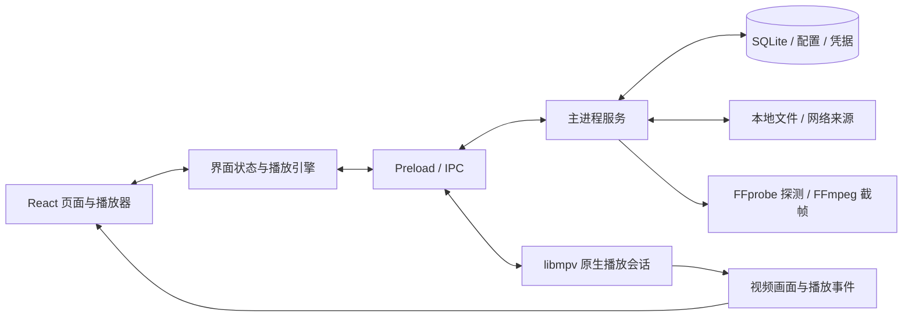

# 软件架构

Aurora Player 由 Electron 主进程、Preload 和 React 渲染进程组成。视频播放使用 libmpv，媒体库和下载任务使用本地 SQLite 数据库。

## 代码入口

| 路径 | 负责内容 |
| --- | --- |
| `src/main/index.ts` | 应用启动、窗口、服务装配与 IPC 注册 |
| `src/main/library/` | 媒体记录、播放历史、队列和数据库 |
| `src/main/remote/` | 网络协议访问与远程流代理 |
| `src/main/media/` | 媒体探测、封面生成、本地文件服务 |
| `src/main/playback/` | 播放计划与来源可用性处理 |
| `src/main/system/` | 设置、数据目录、通知、日志与更新检查 |
| `src/preload/` | 向界面暴露受限 API，转发请求和事件 |
| `src/renderer/core/runtime.tsx` | 界面共享状态、导航与主进程订阅 |
| `src/renderer/core/player.ts` | 播放引擎和 libmpv 元素协调 |
| `src/renderer/pages/` | Library、网络媒体、设置和播放器页面 |
| `src/shared/` | IPC 通道及双方共用的数据类型 |
| `scripts/tool.mjs` | 开发、构建、补丁、差分包和发布工具 |

## 播放与封面

- 视频由 `electron-mpv-video` 调用 libmpv 播放；界面负责控制和画面呈现。音频可使用浏览器音频元素，或回退到 libmpv。
- 本地媒体通过回环文件服务提供 URL，远程媒体由来源访问与代理服务提供。播放时不通过 FFmpeg CLI 转码。
- FFprobe 读取轨道等技术信息；FFmpeg 截取视频封面，失败时尝试渲染进程截图。
- 封面、轨道、频谱和拼接图通过 `media/commands.ts` 统一查找工具：开发版使用依赖目录，打包版使用 `resources/app.asar.unpacked/`，再尝试系统 `PATH`；不依赖开发者的磁盘路径。
- 封面路径写入媒体记录后，主进程通知界面更新。重新生成会使用新文件名，避免复用旧图片缓存；Library 的缩略图解码另有数量和内存限制。
- 媒体信息页从 FFprobe 标签显示音频专辑、歌手等信息。视频预览缓存于 `temp/video-previews/`，合成为 3 行、10 列的单张拼接图，显示在媒体信息页顶部右侧；远程取帧限制读取量，无法按需完成时仅在用户确认后下载完整文件。
- 远程拼接图在采样点附近取帧，每次最多读取 256 MiB 且不超过文件大小的 1/4，内存块缓存上限 32 MiB。达到限额或来源不支持范围读取时提示确认下载；网络和编码错误允许直接重试。

## 数据位置

数据根目录由 `src/main/system/dataPaths.ts` 定义：开发版为工程根目录下的 `data/`，打包版为 EXE 所在目录下的 `data/`。

| 相对路径 | 内容 |
| --- | --- |
| `config/settings.json` | 界面与播放设置 |
| `config/remote-sources.json` | 网络连接配置 |
| `database/library.db` | 媒体库、队列、播放列表与下载任务 |
| `security/credentials.bin` | 受保护的网络凭据 |
| `temp/` | 生成的封面与临时文件 |
| `downloads/` | 下载文件 |
| `logs/aurora.log` | 应用日志 |
| `backgrounds/`、`diagnostics/`、`runtime/` | 背景图、诊断导出、Electron 运行缓存 |

原始媒体保留在原位置。数据库使用 WAL；完整备份应在退出应用后复制整个 `data/`，避免遗漏尚未合并的数据库记录。

环境配置见 [开发环境配置](libmpv-runtime.md)，构建和分发见 [工程工具](tooling.md)。
